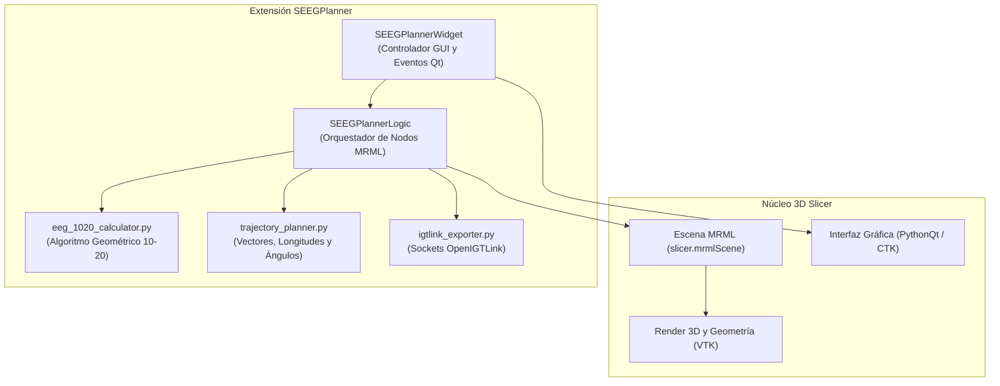

# 📘 Guía y Referencia Técnica del Proyecto SEEGPlanner

> **Trabajo de Fin de Grado:** Grado en Ingeniería de la Salud  
> **Título:** *Desarrollo de una herramienta en 3D Slicer para la planificación de cirugía de electrodos cerebrales en estéreo-electroencefalografía*  
> **Autora:** Alejandra Viñegla Sánchez  
> **Tutores:** Víctor Manuel Smith Fernández (Tutor), David Bueno Vallejo (Cotutor)  
> **Universidad:** Universidad de Málaga (UMA)  
> **Metodología de ingeniería:** Spec-Driven Development (SDD) vía framework [dbv-specs-ops](https://github.com/davidbuenov/dbv-specs-ops)

---

## 📑 Índice de Contenidos

1. [Visión General y Justificación Clínica](#1-visión-general-y-justificación-clínica)
2. [Arquitectura del Software y Entorno 3D Slicer](#2-arquitectura-del-software-y-entorno-3d-slicer)
3. [Fundamentos Matemáticos y Geométricos](#3-fundamentos-matemáticos-y-geométricos)
   - [Sistema de Coordenadas RAS](#31-sistema-de-coordenadas-ras-en-imagen-médica)
   - [Mapeo del Estándar EEG 10-20](#32-mapeo-del-estándar-eeg-10-20-sobre-la-cabeza)
   - [Cálculo de Trayectorias y Parámetros de Seguridad](#33-cálculo-de-trayectorias-y-parámetros-de-seguridad)
   - [Estabilidad del Perno Guía (Ángulo de Inserción Craneal)](#34-estabilidad-del-perno-guía-ángulo-de-inserción-craneal)
4. [Estructura del Código y Responsabilidad de Módulos](#4-estructura-del-código-y-responsabilidad-de-módulos)
5. [Protocolo de Comunicación Quirúrgica (OpenIGTLink)](#5-protocolo-de-comunicación-quirúrgica-openigtlink)
6. [Metodología de Desarrollo: SDD (dbv-specs-ops)](#6-metodología-de-desarrollo-sdd-dbv-specs-ops)
7. [Diario Cronológico de Avances y Decisiones](#7-diario-cronológico-de-avances-y-decisiones)
8. [Preguntas Frecuentes y Guía de Defensa para el Tribunal](#8-preguntas-frecuentes-y-guía-de-defensa-para-el-tribunal)

---

## 1. Visión General y Justificación Clínica

### ¿Qué es la SEEG y por qué es necesaria?
La **estereoelectroencefalografía (SEEG)** es una intervención neuroquirúrgica mínimamente invasiva utilizada en pacientes que padecen **epilepsia farmacorresistente** (pacientes cuyas crisis no remiten con medicación) y que son candidatos a cirugía resectiva de la zona epileptógena (extirpación de la parte del cerebro donde se originan las crisis).

Para identificar con precisión milimétrica qué tejido extirpar sin dañar áreas elocuentes (lenguaje, motricidad), se implantan múltiples electrodos intracraneales (típicamente entre 8 y 18 electrodos finos semirrígidos con múltiples contactos de registro).

### El Problema Clínico
- **Riesgo Hemorrágico:** La complicación más temida es la hemorragia por daño a vasos sanguíneos cerebrales (arterias o venas corticales y profundas). Ocurre en torno al **1% de los procedimientos** y puede causar secuelas neurológicas permanentes o la muerte.
- **Planificación Manual y Dependiente:** Tradicionalmente se realiza de forma manual en estaciones comerciales cerradas (propietarias, costosas y opacas).
- **Desconexión con el EEG 10-20:** En la fase previa, los neurólogos registran las crisis mediante un electroencefalograma convencional de superficie colocado según el estándar internacional 10-20. Es de enorme valor clínico que los puntos de entrada quirúrgicos se relacionen directamente con las derivaciones del EEG donde se detectó la actividad ictal/interictal anormal.
- **Fijación de Tornillos Guía (Anchor Bolts):** Cada electrodo entra al cráneo a través de un perno o tornillo guía roscado al hueso. Si el orificio se realiza con un ángulo muy oblícuo respecto a la superficie del cráneo, el tornillo no ajusta con firmeza, la broca puede resbalar y el electrodo pierde trayectoria o estabilidad.

### La Solución Aportada por este TFG
Una **extensión de código abierto en 3D Slicer** que:
1. Automatiza la colocación de la rejilla estándar EEG 10-20 sobre la cabeza del paciente como candidatos a puntos de entrada.
2. Une los puntos de entrada con las estructuras cerebrales diana profundas (hipocampo, amígdala, etc.).
3. Calcula en tiempo real las métricas de seguridad (longitud, ángulo respecto a la normal del hueso y colisión con vasos).
4. Exporta las coordenadas hacia los neuronavegadores de quirófano usando protocolos abiertos (**OpenIGTLink**).

---

## 2. Arquitectura del Software y Entorno 3D Slicer

### ¿Por qué 3D Slicer?
3D Slicer es la plataforma académica y clínica de referencia a nivel mundial para el procesamiento y visualización tridimensional de imágenes médicas (resonancia magnética, tomografía computarizada, etc.). Es gratuita, de código abierto y ampliamente utilizada en neurocirugía asistida por ordenador.

### Paradigma de Módulo: `ScriptedLoadableModule`
En 3D Slicer existen tres formas de crear extensiones: CLI (línea de comandos), Loadable Modules (en C++) y **Scripted Loadable Modules (en Python 3)**. Este proyecto utiliza la modalidad *Scripted* porque:
- Permite desarrollo ágil y modificaciones en caliente sin necesidad de compilar código C++.
- Ofrece acceso total a las APIs de C++ subyacentes mediante enlaces automáticos en Python (`PythonQt`, `MRML`, `VTK`, `ITK`).
- Permite diseñar interfaces gráficas ricas utilizando la librería **Qt** y los componentes especializados de **CTK** (*Common Toolkit*).

### El Árbol de Escena MRML (Medical Reality Modeling Language)
Toda la información médica en 3D Slicer se gestiona en un árbol centralizado de datos denominado **escena MRML** (`slicer.mrmlScene`). Ningún dato se guarda en variables sueltas; todo elemento del paciente es un **Nodo MRML**:
- `vtkMRMLScalarVolumeNode`: Representa la resonancia magnética 3D (matriz de vóxeles de intensidades).
- `vtkMRMLMarkupsFiducialNode`: Representa colecciones de puntos de interés tridimensionales (ej. Nasion, Inion, puntos 10-20).
- `vtkMRMLMarkupsLineNode`: Representa las líneas de trayectoria quirúrgica entre el punto de entrada craneal y la diana profunda.
- `vtkMRMLModelNode`: Representa mallas poligonales 3D (ej. la superficie reconstruida de la piel o del cráneo).



---

## 3. Fundamentos Matemáticos y Geométricos

### 3.1. Sistema de Coordenadas RAS en Imagen Médica
En 3D Slicer, las coordenadas espaciales tridimensionales de cualquier punto anatómico se expresan en el sistema **RAS**:
- **R (Right):** Eje $X$ (positivo hacia la derecha del paciente).
- **A (Anterior):** Eje $Y$ (positivo hacia la parte anterior/frontal del paciente).
- **S (Superior):** Eje $Z$ (positivo hacia la parte superior/cabeza del paciente).

*Nota importante para la defensa:* Otros formatos médicos (como DICOM estándar o ITK puro) usan **LPS** (*Left, Posterior, Superior*). 3D Slicer realiza la conversión automáticamente entre LPS y RAS, por lo que toda la matemática interna de nuestro módulo opera en **espacio RAS milimétrico**.

---

### 3.2. Mapeo del Estándar EEG 10-20 sobre la Cabeza
El sistema internacional 10-20 posiciona electrodos de registro basándose en cuatro referencias anatómicas fijas en el cráneo:
1. **Nasion ($N_z$):** Depresión en la raíz de la nariz, entre los dos ojos.
2. **Inion ($I_z$):** Prominencia ósea palpable en la parte inferior del hueso occipital.
3. **LPA ($LPA$):** Depresión preauricular izquierda (justo por delante del trago de la oreja izquierda).
4. **RPA ($RPA$):** Depresión preauricular derecha.

#### Cálculo de los Arcos Principales:
1. **Línea Sagital (Nasion $\to$ Inion):**  
   Se traza la curva geodésica o arco sagital a lo largo de la superficie superior de la cabeza pasando por el vértice ($Cz$).
   - A un $10\%$ de la distancia total desde Nasion hacia Inion se ubica **$Fpz$**.
   - A intervalos del $20\%$ sucesivos se sitúan: **$Fz$**, **$Cz$** (vértice central, punto medio $50\%$), y **$Pz$**.
   - A un $10\%$ restante del Inion se sitúa **$Oz$**.
2. **Línea Coronal (LPA $\to$ Cz $\to$ RPA):**  
   Une ambos puntos preauriculares pasando por $Cz$.
   - A un $10\%$ desde LPA: **$T3$** (o $T7$ en nomenclatura moderna).
   - Intervalos de $20\%$: **$C3$**, **$Cz$**, **$C4$**.
   - A un $10\%$ antes de RPA: **$T4$** (o $T8$).
3. **Circunferencia Transversal:**  
   Se recorre el perímetro craneal pasando por $Fpz$, $T3$, $Oz$, $T4$ y cerrando en $Fpz$, posicionando electrodos intermedios ($Fp1, Fp2, F7, F8, P7, P8, O1, O2$).

---

### 3.3. Cálculo de Trayectorias y Parámetros de Seguridad

Dada una posición de entrada en el cráneo $\mathbf{P}_{\text{entry}} = (x_e, y_e, z_e)$ (obtenida del mapeo 10-20 o ajustada por el cirujano) y una diana anatómica en el cerebro profundo $\mathbf{P}_{\text{target}} = (x_t, y_t, z_t)$ (ej. núcleo del hipocampo):

1. **Vector Director de la Trayectoria:**
   $$\vec{v} = \mathbf{P}_{\text{target}} - \mathbf{P}_{\text{entry}}$$
2. **Longitud de Penetración del Electrodo ($L$):**
   $$L = \|\vec{v}\| = \sqrt{(x_t - x_e)^2 + (y_t - y_e)^2 + (z_t - z_e)^2}$$
   *Criterio clínico:* Esta longitud es vital para que el cirujano seleccione el modelo físico de electrodo comercial (que vienen en longitudes discretas estandarizadas, ej. 35 mm, 40 mm, 50 mm, etc.).
3. **Vector Unitario de Inserción ($\hat{u}$):**
   $$\hat{u} = \frac{\vec{v}}{\|\vec{v}\|}$$

---

### 3.4. Estabilidad del Perno Guía (Ángulo de Inserción Craneal)

Para que el tornillo guía (anchor bolt) quede roscado sólidamente en el hueso parietal, frontal o temporal:
- Sea $\vec{n} = (n_x, n_y, n_z)$ el **vector normal** a la superficie del cráneo en el punto $\mathbf{P}_{\text{entry}}$, orientado **hacia el exterior** del cráneo.
- El ángulo de inclinación $\theta$ entre la trayectoria del electrodo y la normal de la superficie ósea viene dado por el producto escalar:
  $$\cos(\theta) = \frac{\vec{n} \cdot (-\hat{u})}{\|\vec{n}\| \|\hat{u}\|} = \frac{-\vec{n} \cdot \vec{v}}{\|\vec{n}\| \|\vec{v}\|}$$
  $$\theta = \arccos\left(\frac{-\vec{n} \cdot \vec{v}}{\|\vec{n}\| \|\vec{v}\|}\right)$$
- **Regla de Seguridad Quirúrgica:**
  - Si $\theta \le 30^\circ$: Trayectoria con **fijación óptima** (tornillo estable).
  - Si $30^\circ < \theta \le 45^\circ$: **Aviso de advertencia** (requiere comprobación del grosor de la tabla ósea).
  - Si $\theta > 45^\circ$: **Peligro crítico** (alto riesgo de deslizamiento de la broca o fijación insuficiente; el sistema sugiere desplazar ligeramente el punto de entrada).

---

## 4. Estructura del Código y Responsabilidad de Módulos

El código de la herramienta se localiza en la carpeta `SEEGPlanner/` desacoplada del framework de gestión:

```text
SEEGPlanner/
├── CMakeLists.txt              # Configuración para empaquetar en el catálogo de extensiones de Slicer
├── README.md                   # Instrucciones de instalación en Slicer para usuarios y médicos
├── SEEGPlanner.py              # Clase principal: contiene el Widget de la interfaz y la Lógica central
├── Resources/
│   └── Icons/
│       └── SEEGPlanner.png     # Icono visible en el menú desplegable de Slicer
├── Logic/
│   ├── __init__.py
│   ├── eeg_1020_calculator.py  # Algoritmos geométricos 3D de interpolación y cálculo de rejilla 10-20
│   ├── trajectory_planner.py   # Métricas de distancia, vectores, ángulos óseos y comprobaciones
│   └── igtlink_exporter.py     # Gestor de sockets y generación de tramas OpenIGTLink
└── Testing/
    └── Python/
        └── test_logic_standalone.py # Pruebas unitarias de cálculo matemático ejecutables sin GUI
```

### Principio de Separación de Responsabilidades (MVC):
1. **Vista / Controlador (`SEEGPlannerWidget`):** Solo gestiona botones, menús desplegables (`qMRMLNodeComboBox`) y eventos de usuario. No realiza cálculos matemáticos pesados.
2. **Modelo / Lógica (`SEEGPlannerLogic` y submódulos en `Logic/`):** Clases puras de Python. Reciben coordenadas numéricas y nodos MRML, realizan el procesamiento y devuelven resultados. Esto permite ejecutar pruebas automatizadas en terminal sin abrir 3D Slicer.

---

## 5. Protocolo de Comunicación Quirúrgica (OpenIGTLink)

### ¿Qué es OpenIGTLink?
Es un protocolo de red abierto de comunicación estandarizado internacionalmente para el intercambio de datos en tiempo real en cirugías e intervenciones guiadas por imagen (Image-Guided Therapy, IGT). Funciona mediante una conexión basada en sockets **TCP/IP**.

### Mensajes Utilizados en SEEGPlanner:
- **`POINT` / `FIDUCIAL`:** Envía las coordenadas tridimensionales de los puntos de entrada ($P_{\text{entry}}$) y de diana ($P_{\text{target}}$) junto con sus nombres (ej. `Fp1-Hipocampo_Izq`).
- **`TRANSFORM`:** Matriz homogénea de transformación $4 \times 4$ que describe la posición y orientación en el espacio tridimensional del eje del electrodo para alimentar el sistema de coordenadas del neuronavegador de quirófano.

---

## 6. Metodología de Desarrollo: SDD (dbv-specs-ops)

El proyecto sigue la disciplina **Spec-Driven Development (SDD)** mediante el framework de ingeniería [dbv-specs-ops](https://github.com/davidbuenov/dbv-specs-ops), estructurado en 6 fases obligatorias:
1. **/spec (Especificación):** Definición detallada del "qué" y "por qué" en `dbv-specs-ops/docs/SPECIFICATIONS.md`.
2. **/plan (Planificación):** Debate de arquitectura y diseño del plan técnico con revisión adversarial en `dbv-specs-ops/implementation_plan.md`.
3. **/build (Construcción):** Programación incremental con cabeceras formales y estándares de código limpio.
4. **/test (Pruebas):** Verificación con tests unitarios e integración en la escena MRML.
5. **/code-simplify (Simplificación):** Auditoría estricta de seguridad, refactorización y eliminación de código redundante.
6. **/ship (Entrega):** Documentación final del hito, actualización de `CHANGELOG.md` y etiquetado de versión en Git.

## 7. Diario Cronológico de Avances y Decisiones

### [2026-11-13] — Fase 8 Completada: Validación Cuantitativa, Benchmarks, Manual Clínico y Memoria de TFG
- **Avance:** Culminación completa de los requisitos del TFG mediante validación end-to-end de las 5 etapas clínicas, generación de manual de usuario exhaustivo y formalización de la memoria académica para la Universidad de Málaga.
- **Implementación y Benchmarks:**
  1. `Testing/Python/test_validation_pipeline.py`: Suite de validación integral con generador anatómico de referencia determinístico offline (resolución 1.0 mm, cráneo y estructuras diana con morfologías cóncavas).
  2. Benchmarks cuantitativos: precisión de longitud ($MAE < 10^{-5}$ mm), precisión de ángulo óseo ($< 0.05^\circ$), repetibilidad del centroide ($100\%$) y sensibilidad/especificidad en detección de colisiones ($100\%$). Latencias subsegundo en todas las fases ($\le 0.12$ s en superficie, $\le 0.08$ s en 10-20, $< 5$ ms en colisión).
  3. `dbv-specs-ops/docs/USER_MANUAL.md`: Manual de usuario clínico paso a paso estructurado en los 5 pasos del panel de Slicer, con tabla de códigos semafóricos de seguridad y guía de troubleshooting.
  4. `dbv-specs-ops/docs/MEMORIA_TFG_ESTRUCTURA.md`: Memoria oficial de TFG estructurada según la normativa de la UMA (Grado en Ingeniería de la Salud) con capítulos 1 a 6, formalización matemática en KaTeX y guión de defensa ante el tribunal.
- **Suite de Pruebas:** Total elevado a 49 tests pasando al 100% con código 0.

### [2026-11-13] — Fase 7 Completada: Exportación Estereotáctica Abierta y Conector OpenIGTLink
- **Avance:** Implementación de exportación a formatos abiertos (JSON, CSV resumen y detallado, Slicer Markups JSON v1.0.0) y conector de red OpenIGTLink v1/v2 nativo en Python.
- **Implementación de Componentes:**
  1. `Logic/igtlink_exporter.py`: Serializadores de ficheros, conversión determinística RAS vs. LPS, cálculo de CRC-64 ECMA-182 y empaquetador binario de 58 bytes big-endian (`TRANSFORM` y `POINT`) con sockets no bloqueantes (timeout 2.0 s).
  2. `SEEGPlanner.py`: Sección 5 de la GUI en `SEEGPlannerWidget` con selectores de formato, sistema de referencia (RAS/LPS), archivo y controles de transmisión OpenIGTLink en tiempo real.
  3. `Testing/Python/test_export_standalone.py`: 11 tests unitarios verificando formatos, CRC-64, paquetes binarios y transmisión contra socket mock.

### [2026-11-05] — Fase 6 Completada: Interfaz Gráfica Avanzada y Cuadro de Mandos Clínico
- **Avance:** Reestructuración guiada en 4 pasos secuenciales, cuadro de mandos interactivo central con semáforo de seguridad en tiempo real, visor de contactos de registro y gestión atómica de la escena MRML.
- **Implementación de Componentes:**
  1. `SEEGPlanner.py`: `trajectoriesTableWidget` con semáforo visual (verde $< 30^\circ$, ámbar $\ge 30^\circ$, rojo ante colisiones), `contactsTableWidget` detallando coordenadas RAS y distancias distales (E01-E18).
  2. Métodos `focusTrajectoryInViews` (recentrado ortogonal 2D) y `removePlannedTrajectoryByIndex` (eliminación atómica en memoria y purgado de nodos en `slicer.mrmlScene` para evitar nodos huérfanos).
  3. `Testing/Python/test_ui_logic_standalone.py`: 6 tests unitarios verificando la lógica de la interfaz.

### [2026-11-05] — Fase 5 Completada: Modelado 3D de Electrodos, Pernos Guía y Colisiones Segmento-Segmento
- **Avance:** Modelado tridimensional paramétrico de electrodos multicontacto y perno guía óseo, cálculo de distribución de contactos y algoritmo analítico exacto de detección de colisiones.
- **Implementación de Componentes:**
  1. `Logic/trajectory_planner.py`: Dataclasses `ElectrodeConfig`, `ContactPoint`, `TrajectoryConflict`. Algoritmo `calculate_electrode_contacts`, generador de malla 3D `generate_electrode_tube_polydata` con perno de titanio coaxial (2.5 mm x 15 mm) y algoritmo analítico continuo $\mathcal{O}(1)$ de distancia mínima entre segmentos 3D `compute_segment_to_segment_distance`.
  2. Función `check_trajectory_conflicts`: Auditoría simultánea de colisión mecánica de pernos en cráneo ($< 10$ mm) y proximidad parenquimatosa ($< 3$ mm).
  3. `Testing/Python/test_trajectories_standalone.py`: 12 tests unitarios.

### [2026-11-05] — Fase 4 Completada: Superficie Craneal 3D, Normales y Proyección EEG 10-20 por Ray-Casting
- **Avance:** Reconstrucción tridimensional de la cabeza y proyección de electrodos 10-20 sobre la anatomía real del paciente.
- **Implementación de Componentes:**
  1. `Logic/skull_surface_extractor.py`: Extracción con *Flying Edges 3D* / *Marching Cubes*, filtrado de conectividad, suavizado sinc y cálculo de normales locales orientadas al exterior con `get_surface_normal_at_point`.
  2. `Logic/eeg_1020_calculator.py`: Algoritmo `project_points_to_surface_mesh` con ray-casting acelerado mediante `vtkOBBTree`.
  3. `Testing/Python/test_surface_standalone.py`: 6 tests unitarios.

### [2026-10-29] — Fase 3 Completada: Gestión de Volúmenes MRI y Localización de Dianas Anatómicas
- **Avance:** Implementación del flujo integral de control de calidad para resonancia magnética cerebral y extracción analítica de centroides diana estereotácticos a partir de segmentaciones MRML.
- **Implementación de Componentes:**
  1. `Logic/target_manager.py`: Creación del módulo central de análisis volumétrico con dataclasses `VolumeMetadata` y `TargetStructure`. Incluye `validate_volume_metadata` para comprobar espaciado de vóxeles ($\le 1.5$ mm) y `compute_segment_target` para computar el centroide espacial ponderado en RAS ($C_{\text{RAS}} = \text{IJKToRAS} \cdot C_{\text{IJK}}$), volumen en $\text{mm}^3$ y verificación de contención en la máscara anatómica (previniendo dianas en ventrículos en geometrías cóncavas).
  2. `SEEGPlanner.py`: Integración en `SEEGPlannerLogic` de los métodos `validateAndInspectVolume`, `alignAndCenterVolume` y `extractTargetsFromSegmentation`.
  3. `SEEGPlannerWidget`: Ampliación de la GUI con tarjeta informativa de propiedades del volumen MRI, botón de centrado ortogonal, selector de nodos `vtkMRMLSegmentationNode`, tabla interactiva de dianas detectadas y sincronización automática del nodo de marcas `SEEG_Targets` con el planificador de trayectorias.
- **Validación y Pruebas Automatizadas:**
  - Nueva suite `test_targets_standalone.py` (6 pruebas de control de volumen, geometrías convexas y cóncavas superadas; 11 pruebas unitarias totales).
  - Ampliación de la suite integrada de Slicer `SEEGPlannerTest` (`test_SEEGPlanner_VolumeAndTargets`) verificada con éxito dentro de 3D Slicer v5.12.3 (`SLICER_TEST_SUCCESSFUL`).

### [2026-10-29] — Fase 2 Completada: Implementación y Validación del Esqueleto de la Extensión
- **Avance:** Creación completa de la estructura de la extensión `SEEGPlanner/` para 3D Slicer con todos sus componentes funcionales.
- **Implementación de Componentes:**
  1. `SEEGPlanner.py`: Módulo principal que integra `ScriptedLoadableModule` (metadatos), `SEEGPlannerWidget` (panel nativo Qt/CTK estructurado en 4 secciones guiadas: MRI, EEG 10-20, Dianas/Trayectorias y Exportación) y `SEEGPlannerLogic` (gestor de nodos MRML de fiduciales y líneas de trayectoria).
  2. `Logic/result.py`: Infraestructura tipada bajo el patrón `Result` (`Ok[T]` y `Err`) cumpliendo los estándares de un solo `return` y validaciones estrictas.
  3. `Logic/eeg_1020_calculator.py`: Algoritmo geométrico de interpolación esférica de arcos sagital, coronal y circunferencial según estándar 10-20 a partir de Nasion, Inion, LPA y RPA.
  4. `Logic/trajectory_planner.py`: Cálculo analítico de vectores de trayectoria, distancias euclídeas (longitud de electrodo) y evaluación del ángulo de perpendicularidad ósea respecto a la normal del cráneo.
  5. `Logic/igtlink_exporter.py`: Generador de matrices de transformación 4x4 y formateador de payloads compatibles con OpenIGTLink y exportación a archivos JSON.
- **Validación y Pruebas Automatizadas:**
  - Ejecución de la suite unitaria independiente `test_logic_standalone.py` (5 pruebas matemáticas superadas).
  - Verificación en el entorno nativo de 3D Slicer v5.12.3 en modo batch (`run_slicer_test.py`), confirmando la correcta creación y manipulación de nodos `vtkMRMLMarkupsFiducialNode` y `vtkMRMLMarkupsLineNode` en la escena médica (`SLICER_TEST_SUCCESSFUL`).
- **Scripts de Lanzamiento:** Creación de scripts multiplataforma `start.sh` / `stop.sh` (macOS/Linux) y `start.cmd` / `stop.cmd` (Windows).

### [2026-10-14] — Inicialización y Adopción del Framework SDD
- **Avance:** Configuración del repositorio Git e integración del framework `dbv-specs-ops` v2.9.0 en la subcarpeta `dbv-specs-ops/`.
- **Decisión Técnica:** Definición formal de la extensión para 3D Slicer v5.12.4 en Python 3 (`ScriptedLoadableModule`).
- **Especificaciones:** Redacción de `SPECIFICATIONS.md` con 8 requisitos funcionales clínicos basados en el anteproyecto formal de la alumna Alejandra Viñegla Sánchez.
- **Revisión Adversarial:** Se fijaron 3 salvaguardas críticas:
  1. Validación de orden y coordenadas RAS de fiduciales para evitar distorsiones en la rejilla 10-20.
  2. Comprobación del sentido hacia el exterior de las normales del cráneo para cálculo fidedigno del ángulo de inclinación de los tornillos guía.
  3. Comunicación OpenIGTLink no bloqueante para evitar congelaciones de la interfaz Qt de Slicer.
- **Creación de Documentación Central:** Creación de este documento `ReferenciaTecnica.md` para concentrar todo el conocimiento del proyecto y servir de apoyo durante el desarrollo y la redacción de la memoria del TFG.

---

## 8. Preguntas Frecuentes y Guía de Defensa para el Tribunal

### P1: ¿Por qué basar los puntos de entrada en el sistema EEG 10-20 en lugar de dejar que el cirujano pinche en cualquier punto del cráneo?
> **Respuesta:** En la fase diagnóstica previa a la cirugía, el paciente es monitorizado con video-EEG de superficie (colocado según el sistema 10-20). Los electrodos que registran las anomalías eléctricas iniciales indican el lóbulo cerebral más activo durante el inicio de la crisis. Relacionar directamente los puntos 10-20 en el software acorta el puente entre la evidencia electrofisiológica y la planificación anatómica tridimensional. Además, el cirujano siempre conserva la capacidad de realizar un ajuste fino interactivo si la vascularización o el hueso lo aconsejan.

### P2: ¿Por qué es tan crítico el ángulo óseo en el punto de inserción?
> **Respuesta:** Los electrodos de SEEG no se introducen a pulso en el cerebro, sino a través de tornillos guía rígidos (anchor bolts) que se roscan en orificios fresados en el hueso craneal. Si el orificio tiene un ángulo mayor de 30°-45° respecto a la normal de la superficie ósea, el tornillo no muerde el hueso con suficiente superficie de rosca, lo que puede provocar que se afloje, que la broca resbale al iniciar el taladrado o que el electrodo sufra una desviación angular milimétrica que en la profundidad del cerebro se traduce en un error de varios milímetros, aumentando el riesgo hemorrágico.

### P3: ¿Por qué utilizar OpenIGTLink en vez de simplemente guardar un archivo de texto con las coordenadas?
> **Respuesta:** OpenIGTLink es un estándar médico interoperable en tiempo real. Al usar este protocolo, el módulo no solo genera ficheros locales (JSON/CSV), sino que puede transmitir directamente las coordenadas y matrices de transformación de cada electrodo por red al software del neuronavegador de quirófano (o a simuladores como 3D Slicer en otra máquina), facilitando un flujo de trabajo digital sin transcripción manual de datos, reduciendo el riesgo de errores humanos.
