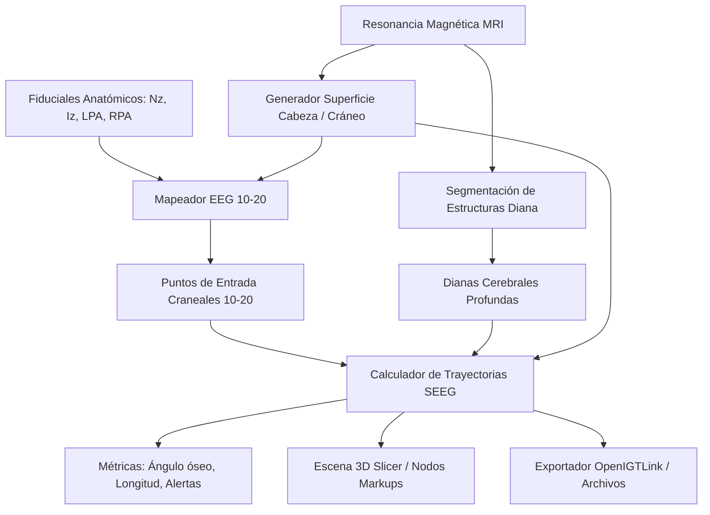

# 🏗 Arquitectura Técnica: SEEGPlanner (Extensión 3D Slicer)

> **Proyecto:** Desarrollo de una herramienta en 3D Slicer para la planificación de cirugía de electrodos cerebrales en estéreo-electroencefalografía.
> **Autora:** Alejandra Viñegla Sánchez
> **Tutores:** Víctor Manuel Smith Fernández, David Bueno Vallejo
> **Fase:** `/plan` (Planificación Técnica)
> **Estado:** Borrador de Arquitectura
> **Última Revisión:** 2026-10-14

---

## 🛠 Stack Tecnológico

| Capa / Componente | Tecnología | Justificación Técnica |
| --- | --- | --- |
| **Plataforma Base** | 3D Slicer (v5.12.4) | Estándar biomédico de código abierto para visualización y análisis de imagen médica |
| **Lenguaje de Desarrollo** | Python 3 (embebido en Slicer) | Permite desarrollo ágil y acceso completo al ecosistema MRML, VTK y algoritmos matemáticos |
| **Gestión de Escena Médica** | MRML (*Medical Reality Modeling Language*) | Estructura en árbol de nodos para datos volumétricos, marcas, modelos 3D y transformaciones |
| **Modelado y Renderizado 3D** | VTK (*Visualization Toolkit*) | Renderizado de trayectorias, superficies corticales y geometrías estereotácticas |
| **Procesamiento de Imagen** | ITK / SimpleITK / NumPy | Filtros de imagen, remuestreo, cálculo de normales de superficie craneal |
| **Interfaz de Usuario (GUI)** | Qt (PythonQt / CTK) | Integración nativa con los widgets estándar de Slicer (`ctkCollapsibleButton`, `qMRMLNodeComboBox`) |
| **Comunicación Quirúrgica** | OpenIGTLink (`OpenIGTLinkIF` / `pyigtl`) | Protocolo abierto estándar para intercomunicación con sistemas de guiado y neuronavegadores |
| **Datasets de Validación** | MRI T1/T2 de repositorios abiertos | Imágenes cerebrales anonimizadas con resolución espacial diagnóstica |

---

## 📂 Estructura de Directorios del Módulo

La extensión se organizará siguiendo el patrón estándar de módulos en Python para 3D Slicer (`ScriptedLoadableModule`):

```text
SEEGPlanner/
├── CMakeLists.txt                       # Manifiesto de empaquetado para Slicer Extension Manager
├── SEEGPlanner.py                       # Módulo principal (SEEGPlanner, SEEGPlannerWidget, SEEGPlannerLogic, SEEGPlannerTest)
├── Resources/
│   ├── Icons/
│   │   └── SEEGPlanner.png              # Icono visual del plugin en la barra de herramientas de Slicer
│   └── UI/
│       └── SEEGPlanner.ui               # Diseño de interfaz gráfica Qt (opcional mediante Qt Designer)
├── Logic/
│   ├── __init__.py
│   ├── result.py                        # Tipos discriminados Result (Ok/Err) para robustez
│   ├── eeg_1020_calculator.py           # Algoritmo de mapeo geométrico y arcos 10-20
│   ├── trajectory_planner.py            # Cálculo de vectores, distancias, longitud y ángulos de seguridad
│   ├── target_manager.py                # Extracción de centroides diana, volúmenes y validación MRI
│   ├── skull_surface_extractor.py       # Extracción y cálculo de normales de la superficie craneal
│   └── igtlink_exporter.py              # Exportación y envío de mensajes OpenIGTLink
└── Testing/
    ├── Python/
    │   └── SEEGPlannerTest.py           # Pruebas automatizadas (unitarias y de escena MRML)
    └── Data/                            # Metadatos de prueba y configuraciones de fiduciales
```

---

## 🔑 Componentes y Flujo de Datos



---

## 📐 Diseño de Algoritmos Clave

### 1. Mapeo del Sistema EEG 10-20
- **Entradas:** 4 coordenadas 3D en espacio RAS del paciente:
  - $N_z$ (Nasion)
  - $I_z$ (Inion)
  - $LPA$ (Punto preauricular izquierdo)
  - $RPA$ (Punto preauricular derecho)
- **Lógica de cálculo:**
  - **Línea Sagital:** Arco geodésico o intersección plano-superficie sobre el cuero cabelludo uniendo Nasion e Inion. Se divide en porcentajes: $10\%$ ($Fpz$), luego pasos del $20\%$ ($Fz$, $Cz$, $Pz$), y $10\%$ final ($Oz$).
  - **Línea Coronal:** Arco uniendo $LPA$, $Cz$ y $RPA$. Divisiones $10\%$ ($T3/T7$), pasos del $20\%$ ($C3$, $Cz$, $C4$), y $10\%$ a $T4/T8$.
  - **Circunferencia:** Intersección transversal uniendo $Fpz$, $T3$, $Oz$, $T4$, $Fpz$.

### 2. Cálculo de la Trayectoria del Electrodo
- Vector director: $\vec{v} = \mathbf{P}_{\text{target}} - \mathbf{P}_{\text{entry}}$.
- Longitud del electrodo: $L = \|\vec{v}\|$.
- Representación MRML: `vtkMRMLMarkupsLineNode` o modelo cilíndrico parametrizado `vtkMRMLModelNode`.

### 3. Ángulo de Inserción Craneal (Estabilidad del Perno Guía)
- Obtención de la normal $\vec{n}$ a la superficie del cráneo en $\mathbf{P}_{\text{entry}}$.
- Ángulo de desviación: $\theta = \arccos\left(\frac{\vec{n} \cdot \vec{v}}{\|\vec{n}\| \|\vec{v}\|}\right)$.
- Validación de seguridad: Comprobar que $\theta < \theta_{\max}$ (típicamente $\le 30^\circ$) para evitar deslizamiento del perno óseo durante el fresado quirúrgico.

---

## 🤖 Configuración del Arnés del Agente (Agent Harness)

- **Contexto Estático:** [`dbv-specs-ops/project.config.md`](file:///Users/bvinegla/Desktop/quinto%20curso/tfgprueba/dbv-specs-ops/project.config.md), [`dbv-specs-ops/docs/SPECIFICATIONS.md`](file:///Users/bvinegla/Desktop/quinto%20curso/tfgprueba/dbv-specs-ops/docs/SPECIFICATIONS.md), [`dbv-specs-ops/memory.md`](file:///Users/bvinegla/Desktop/quinto%20curso/tfgprueba/dbv-specs-ops/memory.md), [`dbv-specs-ops/task.md`](file:///Users/bvinegla/Desktop/quinto%20curso/tfgprueba/dbv-specs-ops/task.md).
- **Entorno de Ejecución:** macOS con 3D Slicer v5.12.4. Ejecución de scripts mediante la consola de Slicer o invocado vía `--python-script` / `--python-code` en modo batch.
- **Guardarraíles de Código:** Respeto riguroso de convenciones de nombres de Slicer (`Logic`, `Widget`, `Node`), manejo de excepciones sin crash de la interfaz gráfica y limpieza de nodos temporales en la escena MRML.
