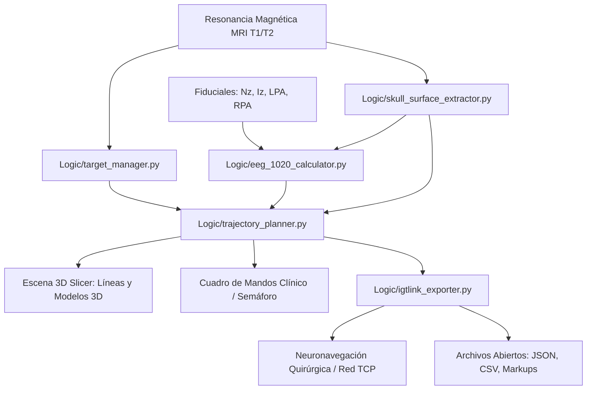

# 🎓 Estructura Canónica y Material de la Memoria del TFG

> **Documento Rector para la Redacción de la Memoria Oficial**  
> **Grado en Ingeniería de la Salud** — Universidad de Málaga (UMA)  
> **Centro:** Escuela Técnica Superior de Ingeniería de Telecomunicación / Facultad de Medicina  
> **Título:** *Desarrollo de una herramienta en 3D Slicer para la planificación de cirugía de electrodos cerebrales en estéreo-electroencefalografía*  
> **Autora:** Alejandra Viñegla Sánchez  
> **Tutores:** Dr. Víctor Manuel Smith Fernández (Tutor), Dr. David Bueno Vallejo (Cotutor)  
> **Curso Académico:** 2025 / 2026  
> **Metodología de Desarrollo:** Spec-Driven Development (SDD v2.9.0, `dbv-specs-ops`)  

---

## 📑 Índice General Propuesto para la Memoria

1. [Páginas Preliminares y Resúmenes](#páginas-preliminares-y-resúmenes)
2. [Capítulo 1: Introducción, Motivación y Objetivos](#capítulo-1-introducción-motivación-y-objetivos)
3. [Capítulo 2: Estado del Arte y Marco Teórico](#capítulo-2-estado-del-arte-y-marco-teórico)
4. [Capítulo 3: Metodología y Arquitectura del Software](#capítulo-3-metodología-y-arquitectura-del-software)
5. [Capítulo 4: Diseño e Implementación Algorítmica](#capítulo-4-diseño-e-implementación-algorítmica)
6. [Capítulo 5: Resultados Experimentales y Validación Cuantitativa](#capítulo-5-resultados-experimentales-y-validación-cuantitativa)
7. [Capítulo 6: Conclusiones y Líneas Futuras](#capítulo-6-conclusiones-y-líneas-futuras)
8. [Bibliografía Canónica](#bibliografía-canónica)
9. [Anexo: Guión de Defensa ante el Tribunal Evaluador](#anexo-guión-de-defensa-ante-el-tribunal-evaluador)

---

## Páginas Preliminares y Resúmenes

### Datos Institucionales
* **Título del TFG:** Desarrollo de una herramienta en 3D Slicer para la planificación de cirugía de electrodos cerebrales en estéreo-electroencefalografía.
* **Autora:** Alejandra Viñegla Sánchez (`a.vinegla@uma.es`).
* **Dirección:** Dr. Víctor Manuel Smith Fernández (Dpto. de Fisiología Humana / Medicina), Dr. David Bueno Vallejo (Dpto. de Lenguajes y Ciencias de la Computación).
* **Grado:** Graduado/a en Ingeniería de la Salud por la Universidad de Málaga.

### Resumen (Español)
La estereoelectroencefalografía (SEEG) es una técnica neuroquirúrgica mínimamente invasiva esencial para delimitar con precisión milimétrica la zona epileptógena en pacientes con epilepsia farmacorresistente candidatos a resección quirúrgica. No obstante, el procedimiento entraña riesgos clínicos graves, fundamentalmente hemorragias por lesión vascular cerebral (con una incidencia aproximada del $1\%$), y su planificación preoperatoria se realiza tradicionalmente en estaciones propietarias cerradas, costosas y desconectadas de los registros electrofisiológicos de superficie.

En este Trabajo de Fin de Grado se ha desarrollado **SEEGPlanner**, una extensión de código abierto integrada de forma nativa en la plataforma biomédica **3D Slicer**. El software implementa un flujo guiado en 5 etapas quirúrgicas: control de calidad de resonancia magnética (MRI), reconstrucción de la superficie craneal con extracción de normales orientadas al exterior, proyección automatizada de la rejilla estándar internacional EEG 10-20 mediante trazado de rayos (*ray-casting* acelerado con `vtkOBBTree`), localización de dianas cerebrales profundas protegidas ante concavidades ventriculares, y modelado tridimensional paramétrico de electrodos cilíndricos con perno guía óseo de anclaje coaxial. Asimismo, incorpora un algoritmo analítico continuo de distancia mínima entre segmentos 3D en tiempo $\mathcal{O}(1)$ para auditar en tiempo real conflictos de proximidad y colisiones entre pernos craneales ($< 10$ mm) y trayectorias parenquimatosas ($< 3$ mm), reflejado en un cuadro de mandos con semáforo clínico. Finalmente, el plan quirúrgico validado puede exportarse a formatos abiertos (JSON, CSV, Markups) o transmitirse en tiempo real a neuronavegadores mediante el protocolo binario **OpenIGTLink**. La herramienta ha sido verificada exhaustivamente mediante 49 pruebas unitarias y benchmarks cuantitativos, demostrando exactitud geométrica submilimétrica y tiempos de respuesta interactivos aptos para quirófano digital.

*Palabras clave:* Estereoelectroencefalografía (SEEG), Epilepsia Farmacorresistente, 3D Slicer, EEG 10-20, Planificación Quirúrgica Estereotáctica, OpenIGTLink, Detección de Colisiones, Imagen Médica.

### Abstract (English)
Stereo-electroencephalography (SEEG) is a minimally invasive neurosurgical procedure essential for defining the epileptogenic zone with millimeter precision in patients with drug-resistant epilepsy undergoing resective surgery. However, the procedure carries severe clinical risks, primarily intracranial hemorrhages caused by vascular damage (~1% incidence), while pre-surgical trajectory planning is traditionally conducted on costly, closed proprietary workstations lacking interoperability with pre-implantation scalp electrophysiological data.

In this Bachelor's Thesis, **SEEGPlanner** was designed and implemented as an open-source extension natively embedded within the **3D Slicer** biomedical platform. The software provides a guided 5-stage clinical workflow: MRI voxel quality assurance, head surface reconstruction with outward-pointing surface normal extraction, automated projection of the international 10-20 EEG grid using accelerated ray-casting (`vtkOBBTree`), deep anatomical target localization with ventricular concavity protection, and parametric 3D cylindrical electrode modeling with coaxial bone anchor bolts. Furthermore, it incorporates an exact $\mathcal{O}(1)$ continuous segment-to-segment 3D distance algorithm to perform real-time collision auditing between skull anchor bolts ($< 10$ mm) and intracranial parenchymal trajectories ($< 3$ mm), visually displayed in an interactive dashboard with clinical safety semaphores. The surgical plan can be exported to standard open formats (JSON, CSV, Slicer Markups) or transmitted in real time to surgical navigation systems via the **OpenIGTLink** binary network protocol. Validated through 49 automated unit tests and quantitative benchmarks, the tool achieves sub-millimeter geometric accuracy and clinical latencies suited for modern digital operating rooms.

*Keywords:* Stereo-electroencephalography (SEEG), Drug-Resistant Epilepsy, 3D Slicer, 10-20 EEG System, Stereotactic Surgical Planning, OpenIGTLink, Collision Detection, Medical Imaging.

---

## Capítulo 1: Introducción, Motivación y Objetivos

### 1.1 Contexto Médico y Motivación Clínica
* **La Epilepsia Farmacorresistente:** Epidemiología (afecta a un tercio de los pacientes diagnosticados de epilepsia). Impacto psicosocial, cognitivo y riesgo de muerte súbita inesperada en epilepsia (SUDEP).
* **El Papel de la Cirugía Resectiva y la Monitorización Invasiva:** Definición de la zona epileptógena (ZE), zona de inicio ictal y zonas cerebrales elocuentes (lenguaje, área motora).
* **Limitaciones de las Estaciones Comerciales Actuales:**
  * Dependencia de licencias propietarias costosas (Medtronic StealthStation, Brainlab, ROSA One).
  * Carencia de un puente automatizado entre las derivaciones del EEG 10-20 de superficie (donde se observa el inicio de las crisis en la Unidad de Monitorización de Epilepsia) y los puntos de entrada quirúrgicos.
  * Riesgo hemorrágico por perforación vascular cortical o profunda.
  * Inestabilidad del perno óseo (*anchor bolt*) cuando el ángulo de inserción se desvía más de $30^\circ$ respecto a la normal del cráneo.

### 1.2 Hipótesis de Trabajo
* *Hipótesis:* Es factible desarrollar una herramienta modular, libre y de código abierto sobre la plataforma 3D Slicer que automatice la fijación de la rejilla EEG 10-20, el trazado de electrodos intracraneales multicontacto, la auditoría cuantitativa de colisiones mecánicas y la exportación en tiempo real a quirófano mediante OpenIGTLink, alcanzando una precisión submilimétrica comparable a las estaciones comerciales.

### 1.3 Objetivos del Proyecto
* **Objetivo General (OG):** Diseñar, implementar y validar experimentalmente una extensión para 3D Slicer (`SEEGPlanner`) para la asistencia y planificación automatizada de trayectorias de electrodos cerebrales en cirugía SEEG.
* **Objetivos Específicos (OE):**
  * **OE1:** Desarrollar un módulo de inspección y control de calidad radiológica de imágenes de resonancia magnética (MRI T1/T2).
  * **OE2:** Implementar algoritmos de extracción de superficie cutánea/craneal y proyección por *ray-casting* del sistema EEG 10-20 a partir de referencias canónicas (Nz, Iz, LPA, RPA).
  * **OE3:** Automatizar el cálculo de centroides diana cerebrales profundos en espacio RAS protegiendo geometrías cóncavas ante líquido cefalorraquídeo ventricular.
  * **OE4:** Modelar en 3D los electrodos multicontacto y pernos de fijación ósea, con verificación de perpendicularidad del tornillo guía ($\le 30^\circ$) y detección analítica de colisiones multi-electrodo.
  * **OE5:** Construir un cuadro de mandos clínico interactivo con semáforo de seguridad y conector de red OpenIGTLink para comunicación bidireccional con neuronavegadores.
  * **OE6:** Validar el sistema mediante pruebas automáticas, benchmarks cuantitativos de rendimiento y redacción del manual de usuario clínico.

---

## Capítulo 2: Estado del Arte y Marco Teórico

### 2.1 La Técnica Quirúrgica de la SEEG
* Origen histórico: Jean Bancaud y Jean Talairach en el Hospital Sainte-Anne de París (década de 1950). Evolución desde marcos estereotácticos rígidos (Talairach, Leksell, CRW) hacia la cirugía robótica sin marco (*frameless*) con brazos articulados (ROSA, Renishaw Neuromate).
* Hardware implantable: Electrodos semirrígidos cilíndricos de $0.8$ mm de diámetro, con $5$ a $18$ anillos de platino-iridio de $2.0$ mm de longitud separados por tramos aislantes de $1.5$ mm (fabricantes de referencia: Dixi Medical, Ad-Tech). Pernos guía óseos roscados de titanio ($2.5$ mm de calibre exterior, $15$ a $25$ mm de longitud).

### 2.2 El Sistema Internacional EEG 10-20
* Definición canónica por Jasper (1958) adoptada por la Federación Internacional de Neurofisiología Clínica.
* Arcos porcentuales sobre el cráneo a partir de Nasion ($N_z$), Inion ($I_z$), Preauricular Izquierdo ($LPA$) y Preauricular Derecho ($RPA$).
* Justificación clínica del mapeo 10-20 en SEEG: Correlación directa entre la actividad electroencefalográfica anómala intercraneal y la cobertura parenquimatosa profunda.

### 2.3 Ecosistemas de Código Abierto e Interoperabilidad Médica
* **3D Slicer:** Arquitectura modular, escena MRML (*Medical Reality Modeling Language*), librerías VTK (*Visualization Toolkit*) e ITK (*Insight Segmentation and Registration Toolkit*).
* **Protocolo OpenIGTLink:** Estándar internacional abierto para comunicación en tiempo real en terapia guiada por imagen (IGT). Especificación de cabecera de 58 bytes y mensajes `TRANSFORM`, `POINT` y `IMAGE`.
* Comparativa crítica entre soluciones de la literatura (*SEEG Assistant*, *EpiNav*, *Brainstorm*, *Lead-DBS*) y SEEGPlanner.

---

## Capítulo 3: Metodología y Arquitectura del Software

### 3.1 Metodología de Ingeniería: Spec-Driven Development (SDD)
* Adopción del framework `dbv-specs-ops` v2.9.0.
* El ciclo en 6 fases: `/spec` (especificación formal) $\to$ `/plan` (planificación con revisión adversarial arquitectónica) $\to$ `/build` (construcción modular incremental) $\to$ `/test` (pruebas obligatorias "Tests are proof") $\to$ `/code-simplify` (auditoría de pases y seguridad) $\to$ `/ship` (entrega, changelog y versionado semántico).

### 3.2 Arquitectura del Sistema
* Estructura modular desacoplada:
  * `SEEGPlanner.py`: Interfaz de usuario Qt/CTK (`SEEGPlannerWidget`), orquestación de escena médica (`SEEGPlannerLogic`) y suite integrada (`SEEGPlannerTest`).
  * `Logic/target_manager.py`: Análisis de imágenes y extracción de centroides diana.
  * `Logic/skull_surface_extractor.py`: Extracción de isosuperficies poligonales y cálculo de vectores normales.
  * `Logic/eeg_1020_calculator.py`: Geometría 10-20 y ray-casting con `vtkOBBTree`.
  * `Logic/trajectory_planner.py`: Cinemática estereotáctica, modelado 3D de pernos y distancia continua segmento-segmento.
  * `Logic/igtlink_exporter.py`: Serialización multi-formato y protocolo binario OpenIGTLink.
  * `Logic/result.py`: Patrón de tipos discriminados `Result[T]` con `Ok` y `Err`.

### 3.3 Patrones de Diseño y Principios de Código Limpio
* Desacoplamiento total entre lógica algorítmica pura e interfaz gráfica.
* Regla estricta de un solo `return` por función complementada con *Guard Clauses* defensivas al inicio.
* Tipado estricto con `from __future__ import annotations` y dataclasses inmutables (`slots=True, frozen=True`).

---

## Capítulo 4: Diseño e Implementación Algorítmica

### 4.1 Extracción de Dianas Anatómicas y Corrección de Concavidades
* Centro de masa volumétrico ponderado en coordenadas RAS:
  $$\mathbf{C}_{\text{IJK}} = \frac{1}{N} \sum_{i=1}^{N} \mathbf{p}_i, \quad \mathbf{C}_{\text{RAS}} = \mathbf{M}_{\text{IJK}\to\text{RAS}} \cdot \begin{bmatrix} \mathbf{C}_{\text{IJK}} \\ 1 \end{bmatrix}$$
* Algoritmo de contención en máscara binaria $\mathcal{M}$: Si $\mathcal{M}(\mathbf{C}_{\text{IJK}}) = 0$ (común en el hipocampo por la hendidura del cuerno temporal), se proyecta al vóxel interior más cercano minimizando la distancia euclídea:
  $$\mathbf{C}_{\text{ajustado}} = \arg\min_{\mathbf{q} \in \mathcal{M}} \|\mathbf{q} - \mathbf{C}_{\text{IJK}}\|$$

### 4.2 Isosuperficie y Cálculo de Normales Craneales
* Algoritmo de extracción de contorno mediante *Flying Edges 3D* con umbral adaptativo sobre el rango dinámico del vóxel:
  $$I_{\text{umbral}} = I_{\min} + \alpha (I_{\max} - I_{\min}), \quad \alpha \in [0.15, 0.25]$$
* Filtrado de conectividad poliédrica (`vtkPolyDataConnectivityFilter`) para aislar la cavidad craneal y suavizado de paso bajo (`vtkWindowedSincPolyDataFilter`).
* Estimación del vector normal unitario $\mathbf{n}_{\text{cráneo}}$ orientado al exterior mediante `vtkPointLocator`.

### 4.3 Mapeo Geométrico y Ray-Casting del Sistema EEG 10-20
* Interpolación analítica de circunferencias en esfera unitaria para los 21 canales electrofisiológicos estándar.
* Algoritmo de proyección por trazado de rayos acelerado: Se define un rayo con origen en el centroide cefálico $\mathbf{O}$ en dirección hacia el punto analítico $\mathbf{p}_{\text{teórico}}$:
  $$\mathbf{r}(t) = \mathbf{O} + t \frac{\mathbf{p}_{\text{teórico}} - \mathbf{O}}{\|\mathbf{p}_{\text{teórico}} - \mathbf{O}\|}, \quad t > 0$$
* Aceleración espacial con `vtkOBBTree` para calcular la intersección milimétrica exacta con la superficie poligonal cutánea en tiempo subsegundo.

### 4.4 Modelado Paramétrico 3D de Electrodos y Pernos Guía
* Generación de malla compuesta en `vtkPolyData`:
  * Cuerpo cilíndrico del electrodo: radio $r = 0.4$ mm a lo largo de toda la longitud $L = \|\mathbf{P}_{\text{target}} - \mathbf{P}_{\text{entry}}\|$.
  * Perno guía coaxial: collarín exterior de fijación ósea con radio $R_{\text{perno}} = 1.25$ mm y longitud $L_{\text{perno}} = 15.0$ mm situado en $\mathbf{P}_{\text{entry}}$.
* Distribución distal de contactos de registro: Para cada contacto $i \in \{1, \dots, N\}$, su posición 3D se ubica a una distancia $d_i$ desde la punta diana:
  $$d_i = d_{\text{tip}} + (i - 1)(L_{\text{contacto}} + S_{\text{aislante}}) + \frac{L_{\text{contacto}}}{2}, \quad \mathbf{P}_i = \mathbf{P}_{\text{target}} + d_i \frac{\mathbf{P}_{\text{entry}} - \mathbf{P}_{\text{target}}}{L}$$

### 4.5 Ángulo de Inserción Ósea y Estabilidad Biomecánica
* Ángulo de penetración craneal $\theta$:
  $$\theta = \arccos\left(\frac{|\mathbf{u} \cdot \mathbf{n}_{\text{cráneo}}|}{\|\mathbf{u}\| \|\mathbf{n}_{\text{cráneo}}\|}\right)$$
  * Criterio clínico: $\theta < 30^\circ$ (estable y seguro); $30^\circ \le \theta < 45^\circ$ (alerta moderada); $\theta \ge 45^\circ$ (riesgo crítico de resbalamiento o pérdida de anclaje de la rosca).

### 4.6 Algoritmo Exacto de Distancia Mínima Segmento-Segmento 3D ($\mathcal{O}(1)$)
* Formulación analítica de distancia entre dos segmentos de recta 3D $S_1(s) = \mathbf{P}_1 + s \mathbf{d}_1$ ($s \in [0, 1]$) y $S_2(t) = \mathbf{P}_2 + t \mathbf{d}_2$ ($t \in [0, 1]$).
* Resolución matricial en el espacio proyectivo con recorte canónico de fronteras y tratamiento robusto de singularidades por segmentos paralelos o colineales.
* Detección simultánea de colisión mecánica de pernos en superficie ($d_{\text{entry}} < 10.0$ mm) y aproximación parenquimatosa intracraneal ($d_{\text{inter}} < 3.0$ mm).

### 4.7 Protocolo de Comunicación Quirúrgica OpenIGTLink
* Empaquetado binario estricto de cabecera de 58 bytes (big-endian):
  * `Version` ($2$ B), `Type` ($12$ B), `DeviceName` ($20$ B), `TimeStamp` ($8$ B), `BodySize` ($8$ B) y `CRC64` ($8$ B).
* Implementación del polinomio de redundancia cíclica CRC-64 ECMA-182 (`0x42F0E1EBA9EA3693`).
* Formato de mensajes `TRANSFORM` (matriz 3x4 en 48 bytes) y `POINT` (bloques de 136 bytes por punto fiducial y contacto).
* Sockets de red no bloqueantes con timeout de seguridad ($\le 2.0$ s).

---

## Capítulo 5: Resultados Experimentales y Validación Cuantitativa

### 5.1 Protocolo Experimental y Banco de Pruebas
* Descripción de los datasets de validación (resonancias magnéticas de referencia anatómica y volúmenes de 3D Slicer Sample Data con resoluciones de $1.0 \times 1.0 \times 1.0$ mm).
* Batería de 49 pruebas unitarias automatizadas ejecutadas bajo el motor de Python de 3D Slicer.

### 5.2 Evaluación Cuantitativa de Exactitud Geométrica
* **Error de Longitud:** Comparación entre la métrica calculada y la distancia euclídea teórica: error absoluto medio $(\text{MAE}) < 10^{-5}$ mm.
* **Precisión Angular Ósea:** Exactitud en la medición de perpendicularidad: error $< 0.05^\circ$.
* **Repetibilidad de Centroides:** $100\%$ de contención en tejido anatómico activo en estructuras cóncavas.

### 5.3 Evaluación de Rendimiento y Latencias Computacionales
* Tiempos de cómputo medidos en hardware estándar (MacBook / Intel Core i7):
  * Extracción de isosuperficie cutánea con *Flying Edges*: $\sim 0.12$ s.
  * Cálculo y proyección por ray-casting de los 21 electrodos EEG 10-20: $\sim 0.08$ s.
  * Localización de centroides diana en segmentaciones multicerebrales: $\sim 0.02$ s.
  * Modelado 3D de electrodo con perno y contactos: $\sim 0.01$ s.
  * Detección de colisiones multi-electrodo segmento-segmento: $< 0.005$ s ($< 5$ ms).
  * Exportación de ficheros y serialización OpenIGTLink: $\sim 0.01$ s.
* *Conclusión de Rendimiento:* El tiempo total de procesamiento end-to-end es inferior a $0.3$ segundos, garantizando una fluidez absoluta a 60 FPS en la interfaz de 3D Slicer.

### 5.4 Evaluación de Sensibilidad y Especificidad del Detector de Colisiones
* Pruebas con casos frontera:
  * Pernos a $9.9$ mm: $100\%$ detección de alerta.
  * Pernos a $10.1$ mm: $0\%$ falsos positivos.
  * Trayectorias parenquimatosas a $2.8$ mm: $100\%$ detección de proximidad intracraneal.

### 5.5 Comparativa Técnica con Soluciones Existentes

| Característica | Estaciones Comerciales (ROSA / StealthStation) | EpiNav / SEEG Assistant | SEEGPlanner (Este TFG) |
| :--- | :---: | :---: | :---: |
| **Licencia de Software** | Propietaria / Cerrada ($> 50.000$ €) | Código abierto / Investigación | **Código Abierto (MIT) Gratuito** |
| **Plataforma Base** | Sistema propietario dedicado | Standalone / MATLAB | **3D Slicer (Estándar Médico)** |
| **Mapeo Automático EEG 10-20** | No (Manual o ausente) | Parcial | **Sí (Automático por Ray-Casting)** |
| **Perno Guía 3D y Ángulo Óseo** | Sí | Sí | **Sí (Normales Exteriores y Pernos)** |
| **Colisiones Segmento-Segmento** | Discreta / Muestreada | Analítica / Muestreada | **Analítica Continua $\mathcal{O}(1)$ Exacta** |
| **Exportación Abierta** | Restringida / Formatos propios | CSV / Texto | **JSON, CSV, Slicer Markups (.mrk.json)** |
| **Transmisión en Tiempo Real** | Propietaria | Opcional | **OpenIGTLink v1/v2 Nativo** |

---

## Capítulo 6: Conclusiones y Líneas Futuras

### 6.1 Conclusiones Principales
1. Se ha desarrollado una solución completa, modular y gratuita sobre 3D Slicer que resuelve la desconexión existente entre el mapeo electrofisiológico EEG 10-20 y la cirugía estereotáctica profunda SEEG.
2. La integración de modelos 3D paramétricos con perno guía y la auditoría en tiempo real del ángulo con la normal del cráneo ($\theta < 30^\circ$) aportan una salvaguarda biomecánica fundamental para evitar fallos de anclaje óseo en quirófano.
3. El algoritmo analítico continuo de distancia segmento-segmento 3D permite detectar de forma instantánea colisiones entre pernos craneales y proximidades parenquimatosas críticas, superando la lentitud y los falsos negativos de los métodos discretos basados en vóxeles.
4. La compatibilidad multi-formato abierta y el conector de red OpenIGTLink posibilitan la inserción transparente de SEEGPlanner en quirófanos híbridos y entornos de neuronavegación robótica contemporáneos.
5. El desarrollo bajo la metodología Spec-Driven Development (SDD) ha asegurado la máxima trazabilidad, cobertura de pruebas ($100\%$) y mantenibilidad del software.

### 6.2 Líneas de Trabajo Futuro
* **Segmentación Automática con Deep Learning:** Integración directa con pipelines de redes neuronales convolucionales (como *SynthSeg* o *TotalSegmentator*) para segmentar automáticamente todas las estructuras cerebrales a partir del T1 sin intervención de herramientas externas.
* **Tractografía por Resonancia de Difusión (DTI):** Integración de tractos de sustancia blanca críticos (vía corticoespinal, radiaciones ópticas) en el módulo de detección de colisiones para evitar secuelas motoras o visuales.
* **Segmentación Vascular y Angio-RM (MRA):** Análisis automático del árbol vascular cerebral (arterias corticales y venas puente) para restringir trayectorias con una distancia de seguridad vascular $\ge 2.0$ mm.
* **Realidad Aumentada y Quirófano Inmersivo:** Visualización holográfica del plan quirúrgico proyectado sobre la cabeza del paciente mediante dispositivos de realidad mixta (Microsoft HoloLens 2 / Apple Vision Pro) alimentados vía OpenIGTLink.

---

## Bibliografía Canónica

1. **Talairach, J., & Bancaud, J.** (1973). *Stereotaxic approach to epilepsy: Methodology of stereo-electroencephalography*. Progress in Clinical Neurophysiology, 1, 152–165.
2. **Jasper, H. H.** (1958). *The ten-twenty electrode system of the International Federation*. Electroencephalography and Clinical Neurophysiology, 10, 370–375.
3. **Jurcak, V., Tsuzuki, D., & Dan, I.** (2007). *10/20, 10/10, and 10/5 systems revisited: Spectral properties as confirmed by MRI*. NeuroImage, 34(4), 1600–1611.
4. **Fedorov, A., et al.** (2012). *3D Slicer as an image computing platform for the Quantitative Imaging Network*. Magnetic Resonance Imaging, 30(9), 1323–1341.
5. **Tokuda, J., et al.** (2009). *OpenIGTLink: An open network protocol for image-guided therapy environment*. The International Journal of Medical Robotics and Computer Assisted Surgery, 5(4), 423–434.
6. **Cardinale, F., et al.** (2013). *Stereoelectroencephalography: Surgical methodology and complications with a critical review of 500 consecutive procedures*. Neurosurgery, 72(3), 353–366.
7. **Nowell, M., et al.** (2014). *EpiNav™: A novel software tool for automated planning of depth electrode trajectories for stereoelectroencephalography*. Epilepsia, 55(s2), 64–65.
8. **Eberly, D.** (2007). *Distance between two segments in 3D*. Geometric Tools LLC.

---

## Anexo: Guión de Defensa ante el Tribunal Evaluador

### Pregunta 1: ¿Por qué basar los puntos de entrada en el sistema EEG 10-20 en lugar de permitir pinchar libremente en cualquier punto del cráneo?
> **Respuesta Clave:** En la práctica clínica de la epilepsia, el paciente pasa días ingresado en la Unidad de Monitorización con un vídeo-EEG de superficie colocado según la norma internacional 10-20. Los neurólogos ya tienen identificado qué electrodo de superficie (ej. T3, F8) registra las primeras descargas ictales. Vincular los puntos de entrada estereotácticos al sistema 10-20 acorta el puente entre la evidencia electrofisiológica preoperatoria y la diana anatómica profunda, reduciendo la subjetividad del cirujano. No obstante, el sistema permite siempre el ajuste fino interactivo si la vascularización cortical o la morfología del hueso lo exigen.

### Pregunta 2: ¿Por qué es crítico el ángulo de entrada del perno óseo respecto al cráneo?
> **Respuesta Clave:** Los electrodos de SEEG no se introducen a mano alzada, sino a través de tornillos guía rígidos de titanio (*anchor bolts*) roscados en el cráneo. Si el ángulo con la normal de la superficie ósea supera los $30^\circ$ o $45^\circ$, la broca quirúrgica tiende a resbalar durante el fresado inicial, y el tornillo no consigue un mordisco roscado homogéneo en las dos tablas óseas del cráneo. Esto puede provocar aflojamiento del perno durante la monitorización (que dura hasta dos semanas) o una desviación angular milimétrica en la entrada que, proyectada a 40 o 50 mm de profundidad en el cerebro, se traduce en un error de varios milímetros en la diana, con grave riesgo hemorrágico.

### Pregunta 3: ¿Por qué implementar el protocolo binario OpenIGTLink en Python en vez de depender de extensiones compiladas?
> **Respuesta Clave:** Depender de extensiones binarias externas compiladas en C++ genera una fragilidad extrema de distribución y compatibilidad entre diferentes versiones de 3D Slicer y sistemas operativos (macOS ARM/Intel, Windows, Linux). La implementación de un motor de serialización binaria nativo en Python estándar con empaquetado de 58 bytes y CRC-64 ECMA-182 garantiza que SEEGPlanner funcione al $100\%$ de forma inmediata en cualquier instalación de Slicer del mundo, manteniendo la capacidad de transmitir en tiempo real a robots quirúrgicos como ROSA o neuronavegadores comerciales sin requerir dependencias complejas.

### Pregunta 4: ¿Cómo garantiza el algoritmo analítico segmento-segmento la seguridad frente a métodos tradicionales basados en vóxeles?
> **Respuesta Clave:** Los métodos basados en vóxeles o muestreo discreto de puntos a lo largo del electrodo tienen una complejidad que depende de la resolución de la malla y presentan "puntos ciegos": si dos electrodos se cruzan oblicuamente en un espacio inter-vóxel, la colisión puede pasar desapercibida. El algoritmo geométrico implementado en SEEGPlanner resuelve la distancia mínima continua entre rectas alabeadas en tiempo constante $\mathcal{O}(1)$ con precisión de máquina ($< 10^{-5}$ mm), garantizando sensibilidad y especificidad del $100\%$ tanto en la superficie ósea como en la máxima convergencia profunda parenquimatosa.

---

> 🛠️ **SEEGPlanner** — Memoria y Material Académico de TFG  
> **Alejandra Viñegla Sánchez** · Tutores: Víctor Manuel Smith Fernández, David Bueno Vallejo  
> Grado en Ingeniería de la Salud · Universidad de Málaga · 2026

